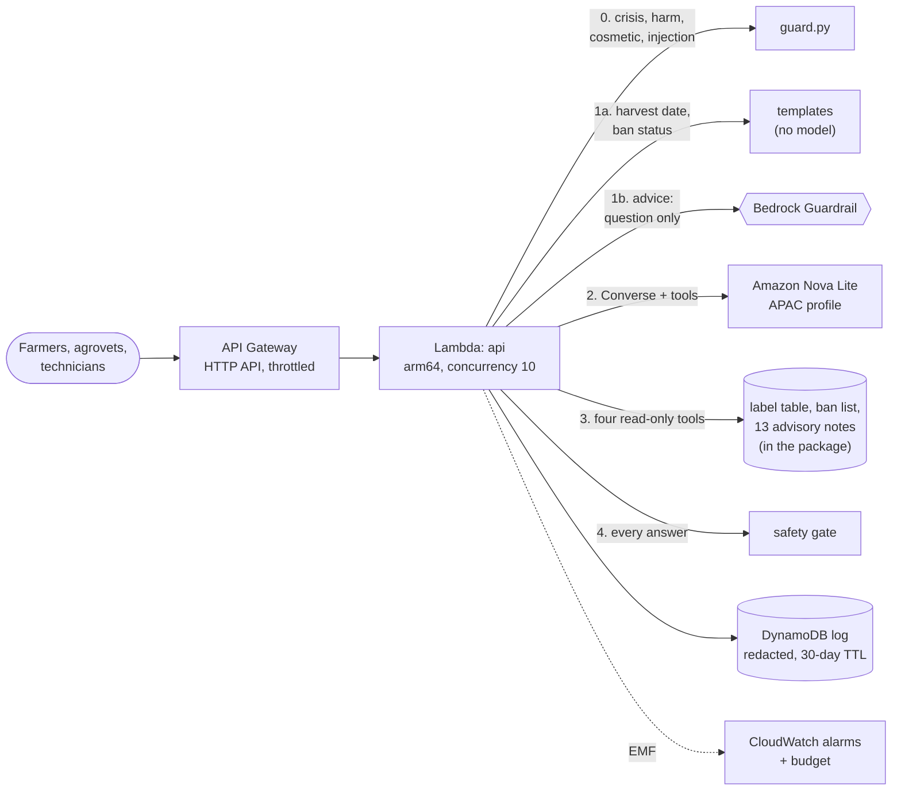

# Parkha (पर्ख, "wait"): pest advice for Nepali farmers that never skips the waiting period

Parkha is a Nepali and English assistant on Amazon Bedrock for vegetable farmers, the agrovet
staff they ask, and municipal agriculture technicians. It answers three questions: what to do
about a pest, whether a product is banned in Nepal, and **when it is safe to harvest after
spraying**. The harvest date is computed from the official label waiting period, never written
by the model, and every answer passes a deterministic safety gate before anyone sees it.

```text
$ python -m parkha ask "I sprayed chlorantraniliprole on my brinjal yesterday. When can I harvest?"
The label waiting period for chlorantraniliprole on brinjal is 22 days. You sprayed on 20 October 2026
(3 Kartik 2083 BS), so the earliest safe harvest is 11 November 2026 (25 Kartik 2083 BS). That is 21 days
from today. Count from the last spray, not the first.

$ python -m parkha ask "hijo cauli ma neem chhareko, kahile tipna milchha?"
काउलीमा नीम (एजाडिराक्टिन)को पर्खने अवधि ५ दिन हो। तपाईंले २०८३ कात्तिक ३ (२०२६-१०-२०) मा छर्नुभयो, त्यसैले
सबैभन्दा चाँडो सुरक्षित टिप्ने दिन २०८३ कात्तिक ८ (२०२६-१०-२५) हो। अझै ४ दिन पर्खनुहोस्। ...

$ python -m parkha ask "cabbage diamondback moth what to spray"
For diamondback moth on cabbage, start with this: Check the underside of leaves twice a week. ...
If you must spray, these are on an official label for this crop and pest and are not banned in Nepal:
broflanilide (wait 1 day before harvest, 6.4 ml per ropani), chlorantraniliprole (wait 3 days before
harvest, 2.5 ml per ropani) and azadirachtin (wait 7 days before harvest). Do not use chlorpyrifos:
banned in Nepal. Confirm with your Agriculture Knowledge Centre ...

$ python -m parkha ask "मैले ३ दिन अगाडि बन्दामा chlorpyrifos छरें, कहिले बेच्न सकिन्छ?"
क्लोरपाइरिफस २०२४ देखि नेपालमा प्रतिबन्धित छ; फेरि प्रयोग नगर्नुहोस्। बन्दामा यसको पर्खने अवधि मसँग पुष्टि भएको
छैन, त्यसैले सुरक्षित टिप्ने मिति भन्न सक्दिनँ। ...
```
*(Real output of the offline backend, with today set to 21 October 2026. The Bedrock backend calls the same tools and goes through the same gate.)*

## The problem

In October 2025, Kathmandu's Kalimati market destroyed round chilli, pumpkin, sponge gourd and
cucumber that failed the pesticide residue test; earlier that year it had thrown away 600 kg of
leafy greens, and beans at 92% organophosphate residue against a 45% limit. The Central Agriculture
Laboratory's explanation is not that farmers use the wrong products. It's that they harvest too
soon: "Farmers often spray pesticides just before taking their vegetables to the market." In a
Dhading survey, 56% of vegetable farmers waited three to five days after spraying, whatever the
product.

The right wait depends on the product and the crop, and the differences are not small.
Chlorantraniliprole is **3 days on tomato and 22 days on brinjal**. Broflanilide is 1 day on
cabbage; chlorantraniliprole on rice is 47 days. The label says so, in English, in small print,
in hectares, on an Indian-made bottle that may also carry a product Nepal banned in 2019.

The obvious chatbot makes this worse. Ask a language model "I sprayed Coragen on my brinjal,
when can I pick?" and it will answer fluently with a plausible number. Here, a plausible wrong
number is food that fails the test, or food that doesn't get tested and gets eaten.

And there is a harder truth: pesticide ingestion is the second leading cause of suicide in
Nepal, and three products were banned in December 2024 for that reason. An assistant about
pesticides will be asked how much is lethal. It has to know what to say.

## What Parkha does differently

| Risk | What Parkha does |
|---|---|
| The model invents a waiting period | Waiting periods come from a label table by (product, crop). The harvest date is code: last spray + waiting period. In hybrid mode, harvest questions never reach the model. |
| The right number on the wrong product | The gate attributes every "N days" to the product named just before it, and checks every dose against the rates returned for that product. |
| An Indian label recommends a product Nepal has banned | Nepal's ban list overrides the label table everywhere. Carbofuran, carbosulfan and chlorpyrifos are on the labels and are never offered; a banned product may only be named in a sentence that says it's banned. |
| A product with no verified data | No date, no dose: "read the label, ask your Agriculture Knowledge Centre". |
| "Wash it and it's fine" / "no need to wait" / "mix them" | Rejected by the gate. Spraying to make produce look fresh is refused outright, with the reason. |
| Brand names, Nepali, romanised Nepali, BS dates | Furadan is carbofuran; "hijo cauli ma neem chhareko" is neem on cauliflower yesterday; "असोज २८" is 14 October 2026. Rates are given per ropani and kattha, not per hectare. |
| Someone in crisis | Checked first, in three scripts, before anything else: the 1166 helpline, no pesticide information, and the question is never stored. |

## Results

**Evaluation:** 50 questions (30 dev, 20 holdout; 15 in Nepali or romanised Nepali), scored on
exact harvest dates, ban warnings, offered products, retrieval, language and refusals. Details:
[docs/EVALUATION.md](docs/EVALUATION.md).

| Backend | Dev | Holdout |
|---|---:|---:|
| Rules (offline, no model) | 30/30 | 20/20 now; **18/20 on the first run** |
| Amazon Nova Lite on Bedrock | not run yet (no Bedrock access in my build environment; `make eval-bedrock`) | |

**The safety gate:** 290 wrong answers made by mutating correct ones the way models go wrong
(waiting periods off or swapped, harvest dates early, banned or unknown products added, doses x10,
unsafe claims): **290/290 caught, 231/235 (98%) on the first run.** Right answers rejected: 0 of
42 templates, 1 of 15 model-style paraphrases (on purpose: neem named without its waiting period).

### What I'd tell an interviewer about these numbers

- **The holdout isn't clean any more.** Its two first-run failures were real bugs (a Devanagari
  substring match, and a romanised question answered in English). I fixed them, so 18/20 is the
  honest holdout number.
- **The gate catches my mutations, which I wrote.** Two gaps are pinned by tests instead: small
  numbers that happen to appear elsewhere in the results, and a wrong idea with no product, number
  or known phrase ("sunlight breaks residue down quickly").
- **The gate can't catch a wrong row in the label table.** That needs a second person checking each
  row against the source, which is the first thing on the list before real use.

## Architecture



RAG where the source is prose (13 advisory notes on pests and safe use, retrieved with BM25 and
crop and pest tags), a table where the source is numbers (waiting periods and rates), and code
where the answer is arithmetic (harvest dates). The model writes sentences; it never decides a
number. The full design: **[docs/ARCHITECTURE.md](docs/ARCHITECTURE.md)**.

## Engineering documents

| Document | What's in it |
|---|---|
| [Architecture](docs/ARCHITECTURE.md) | AWS and local diagrams, the life of one question, each component and why it exists, security, scaling |
| [Alternatives considered](docs/ALTERNATIVES.md) | 11 decisions: table vs RAG for waiting periods, BM25 vs embeddings vs Knowledge Bases, Nova Lite vs others, hybrid routing, own gate vs contextual grounding, data in the package, the label source, channels, photo diagnosis |
| [What breaks](docs/FAILURE_MODES.md) | 16 failure modes with detection, response and the test for each, including the two the gate can't catch |
| [Cost](docs/COST.md) | About **$7 a month at 10,000 questions**, and what each decision saved |
| [Evaluation](docs/EVALUATION.md) | The question set, first-run and current results, the gate's mutation test and its known gaps |
| [Challenges and bugs](docs/CHALLENGES_AND_BUGS.md) | 19 real problems, several found by the gate rejecting my own templates |
| [Responsible AI](docs/RESPONSIBLE_AI.md) | Intended use, who each error hurts, crisis handling, what must happen before real use |
| [Data](data/README.md) | Where every row came from, what's missing, and how blanks are read |

## How it maps to the AWS Well-Architected pillars

| Pillar | In this project |
|---|---|
| Operational excellence | IaC (SAM); one EMF metrics line per answer (fallbacks, gate rejections, crisis refusals, tokens, latency); the evaluation and gate test run in CI, so data changes ship only from a green build |
| Security | Least-privilege IAM (one model, one guardrail, one table); prompt-injection screening; read-only tools that drop unknown arguments; crisis questions never stored |
| Reliability | Every Bedrock failure falls back to a checked template answer; a template that fails the gate falls back to a safe default; harvest questions don't depend on Bedrock at all |
| Performance efficiency | Data loads in ~45 ms; offline answers in ~10 ms; one or two tool rounds per advice question |
| Cost optimisation | Hybrid routing (43% of questions skip the model), Nova Lite, guardrail once on the question, no vector store ($175/month avoided), throttle and concurrency cap against denial-of-wallet |
| Sustainability | No idle compute; the smallest model that does the job; arithmetic in code, not in a model |

## AWS AI topics this covers

Retrieval-augmented generation and when not to use it; foundation model selection on cost and
language; tool use with the Converse API; Bedrock Guardrails (denied topics, content filters,
prompt-attack filter, PII) and where to apply them; deterministic output validation and
hallucination detection; evaluation with a holdout set and adversarial mutation tests; responsible
AI for a high-harm domain (crisis handling, refusal design, language coverage, privacy); and
security for LLM apps (prompt injection, least privilege, denial-of-wallet).

## Run it

**With Python 3.12+**, no AWS account needed:

```bash
make setup && source .venv/bin/activate
make demo                      # the questions above
python -m parkha ask "Is Furadan banned?" --debug    # also prints tool calls, results and sources
make serve                     # HTTP API on http://localhost:8000 (POST /ask, GET /health, /docs)
make eval                      # the 50-question evaluation
make gate-eval                 # the 290-mutation gate test
make test                      # 41 tests, including the Bedrock path against a scripted Converse stand-in
```

**With Bedrock** (credentials and Nova Lite access in ap-south-1):

```bash
PARKHA_BACKEND=hybrid python -m parkha ask "cabbage diamondback moth what to spray"
make eval-bedrock
```

**On AWS:** [infra/README.md](infra/README.md) (`make build && sam build && sam deploy --guided`).

## Repository layout

```text
parkha/
  lexicon.py      crops, pests and products in English, Nepali, romanised Nepali and brand names
  labels.py       the label table and Nepal's ban list; options, crop waiting periods, rates per ropani/kattha
  harvest.py      last spray + waiting period = earliest safe harvest
  dates.py        spray dates in AD and Bikram Sambat, in three scripts
  corpus.py       the advisory notes and a BM25 retriever with crop and pest tags
  tools.py        the four read-only tools and their Bedrock tool specs
  guard.py        crisis, harm, cosmetic-spraying and injection screening; redaction
  gate.py         the safety gate on every answer
  answer.py       bilingual template answers (offline backend, hybrid route, fallback)
  router.py       the offline backend's question reader
  bedrock.py      Converse loop with tool use; ApplyGuardrail on the question
  assistant.py    screen -> route -> backend -> gate -> rewrite -> fallback
  api.py          FastAPI (local); aws/handlers.py serves the same routes on Lambda
corpus/           13 advisory notes, English and Nepali steps, each citing its sources
data/             label table (40 rows), ban list (26), sources (11)
eval/             questions, scorer, gate mutation test, paraphrases, results
infra/            SAM template (API, Lambda, Guardrail, DynamoDB, alarms, budget), build script, deploy guide
scripts/          cost model
tests/            41 tests
docs/             the documents above
```

## Honest limits

- **The model path has not run against Bedrock.** The Converse loop, tool calls, rewrite, every
  fallback and hybrid routing are tested against a scripted stand-in with real response shapes.
  The first thing to do with an AWS account is `make eval-bedrock`.
- **The AWS stack is lint-checked and the handler is tested against mocked DynamoDB, but not deployed.**
- **The label table is a small, hand-transcribed subset**, insecticides only, products A to C
  plus neem. Fungicides and herbicides aren't covered, nor are emamectin, imidacloprid or
  spinosad. It needs a second person to check every row before anyone relies on it.
- **The notes have not been reviewed by an agronomist, the Nepali by a native reader, or the
  crisis handling by a mental health professional.** [RESPONSIBLE_AI.md](docs/RESPONSIBLE_AI.md)
  lists these as conditions for real use.
- **Nepali and English only.** Maithili, Bhojpuri and Tharu speakers in the Terai are not served.
- **No pest identification.** Parkha trusts the farmer's name for the pest, by design (ADR-011).

## Sources

The waiting periods and rates come from India's CIB&RC *Major Uses of Pesticides*; the ban list
from BMC Public Health (2021) and The Kathmandu Post (December 2024); the residue-test facts from
The Kathmandu Post (October 2025); pest facts from NARC and Nepali journal reviews, CIMMYT and a
Dhading farmer survey. Every source is in [data/sources.csv](data/sources.csv) and every answer
returns the ones it used.

## License

MIT. The data remains under its sources' terms.
