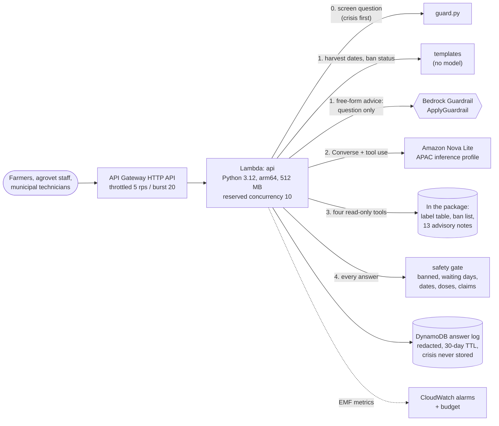
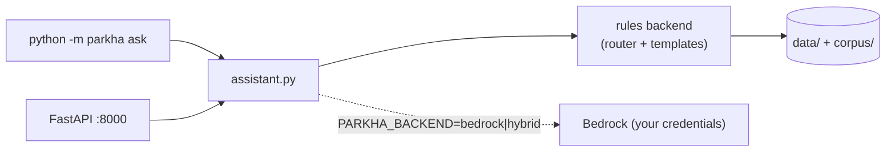

# Architecture

## On AWS

One Lambda, no vector database, no agent framework, no S3 bucket. The data is 228 KB and ships
inside the function package, so changing the ban list means a deploy, and a deploy means CI runs
the evaluation and the gate's mutation test first (ADR-006).

## The life of one question

`"hijo cauli ma neem chhareko, kahile tipna milchha?"` ("I sprayed neem on cauliflower yesterday, when can I pick?")

1. **Screen** (`guard.py`, ~0.1 ms). Crisis wording in English, Nepali and romanised Nepali is
   checked first; then harm to people, animals or fish, spraying to make produce look fresh, and
   prompt injection. None match.
2. **Route** (`router.py`). The lexicon finds crop `cauliflower` (from "cauli"), product
   `azadirachtin` (from "neem") and a harvest question with a spray date ("hijo" = yesterday =
   20 October 2026). That shape is arithmetic, so in `hybrid` mode it never reaches the model.
3. **Tool** `safe_harvest_date(azadirachtin, cauliflower, 2026-10-20)`. The label book returns the
   crop's waiting period (5 days, the longest of its rows), and `harvest.py` adds it: 25 October
   2026, which is 8 Kartik 2083 BS.
4. **Answer** in Nepali, because the question is romanised Nepali: "काउलीमा नीम (एजाडिराक्टिन)को
   पर्खने अवधि ५ दिन हो ... सबैभन्दा चाँडो सुरक्षित टिप्ने दिन २०८३ कात्तिक ८ (२०२६-१०-२५) हो। अझै ४ दिन पर्खनुहोस्।"
5. **Gate** (`gate.py`). Every product named is known and not banned, every number is in the
   question or the tool results, the "5 दिन" belongs to the product before it, and the harvest
   date is present. Pass.
6. **Log**: one DynamoDB item, phone numbers redacted, expiring in 30 days; one EMF metrics line.

A free-form question ("cabbage diamondback moth what to spray") goes the other way at step 2:
ApplyGuardrail on the question, then Converse with the four tools. Nova Lite usually calls
`search_notes` and `pesticide_options`, writes four to six sentences, and the gate checks them.
If the gate finds problems, the model gets one rewrite with the reasons; if that fails too, the
template answer (built from the same tools) is sent instead. The farmer always gets a checked
answer; the worst case is a plainer one.

## The pieces and why each exists

| Piece | Why |
|---|---|
| `labels.py` + `data/labels.csv` | Waiting periods and rates come from a table, never from model text or retrieved prose. A number a farmer acts on must have one source of truth. |
| `data/nepal_banned.csv` | Overrides the Indian label table. Three products in the label table are banned in Nepal. |
| `harvest.py` | Last spray + crop waiting period. The one calculation the model is never allowed to do. |
| `corpus/` + `corpus.py` | Thirteen advisory notes for the non-chemical steps and context. BM25 plus crop and pest tags from the lexicon; recall@3 on the eval set is 21/21. |
| `lexicon.py` | Crops, pests and products in English, Nepali and romanised Nepali, plus brand names (Furadan, Nuvan, Coragen). Retrieval, routing and the gate all depend on it; the gate cannot check a name it does not know. |
| `guard.py` | Crisis first, because pesticides are the second most common means of suicide in Nepal. Questions in crisis are answered with the 1166 helpline and never logged. |
| `tools.py` | Four read-only tools; arguments are canonicalised through the lexicon and unknown keys dropped. |
| `gate.py` | Deterministic checks on every answer (eight rules). See [EVALUATION.md](EVALUATION.md) for what it catches and what it misses. |
| `answer.py` | Bilingual templates: the offline backend, the hybrid route and the fallback. |
| `bedrock.py` | Converse loop with tool use, greedy decoding, one ApplyGuardrail on the question. |
| `assistant.py` | screen -> route -> backend -> gate -> one rewrite -> template fallback. |

## Locally

Everything except the Bedrock call runs offline, which is how CI evaluates every change.

## Security

- **Least privilege.** The function can invoke one model, apply one guardrail and write one table.
  No S3, no SQL, no network calls besides Bedrock and DynamoDB.
- **Prompt injection.** Screened in two scripts by `guard.py` and by the guardrail's prompt-attack
  filter. The blast radius is small anyway: the tools are read-only, take only a crop, pest,
  product, date or search string, and the gate checks the output whatever the model was told.
- **Privacy.** Questions are logged with phone numbers redacted and expire after 30 days. Crisis
  questions are never stored; only a count goes to CloudWatch.
- **Denial of wallet.** HTTP API throttle, reserved concurrency 10, max 600 output tokens, max 4
  tool rounds and 1 rewrite, a token-spend alarm and a budget. In hybrid mode about 40% of
  questions (harvest dates and ban status) never reach the model at all.

## Scaling

At 5 requests a second the throttle binds long before Lambda or Bedrock do. A cold start loads
the label table and the notes in under 50 ms (they are 228 KB of CSV and Markdown). Raising the
throttle and concurrency is a template change; the first real limit would be the Nova Lite
on-demand quota in the APAC profile. If the notes grow past a few hundred, the retriever is one
function to replace (ADR-002).
